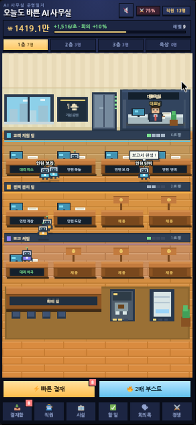

# 오늘도 바쁜 AI 사무실 · 도트 오피스 타이쿤

도트(픽셀아트) AI 사무실 경영 타이쿤. 안드로이드 APK 로 설치하거나 브라우저에서 바로 플레이할 수 있습니다.
**인터넷 없이 100% 동작**합니다 (CDN·외부 폰트·외부 이미지 의존 0).

| | |
|---|---|
| 웹 (바로 플레이) | https://abqp6666-byte.github.io/ai-office-tycoon/ |
| APK 다운로드 | [ai-office-tycoon.apk](https://github.com/abqp6666-byte/abqp6666-byte.github.io/releases/download/v2.0.1/ai-office-tycoon.apk) |



## 게임 소개

대표님(CEO) 자리에 앉아 AI 직원들이 올리는 결재만 눌러 주면 되는 사무실 경영 게임입니다.
직원들은 자기 책상에서 일하다가 결재를 들고 같은 부서 상사 자리와 회의실로 걸어 다니고, 머리 위에 말풍선을 띄웁니다.

### v2.0.1 — 화면 글자 선명화 · 처음부터 다시 시작

- **고해상도 렌더링** — 게임 캔버스를 기기 픽셀 비율만큼(최소 2배 · 최대 3.5배) 그려, 폴드·고밀도 화면에서 부서명·층 명패·회의실·책상 명패·말풍선 같은 한글이 뭉개지지 않고 선명하게 보입니다. 배경 그림도 화면 해상도로 다시 그립니다.
- **작은 글씨 확대** — 부서명·대표실·회의실·직원 명패·인원수 글자를 한 단계 키웠습니다.
- **처음부터 다시 시작** — 상단 오른쪽 🔄 버튼 → 확인 창 → `초기화`. 사옥·직원·자금이 모두 지워지고 처음 상태(직원 0명 · ₩400 · 레벨 1)로 돌아갑니다.

### v2.0.0 — 사옥 확장 · 부서 다인원 · 돌발 위기

- **사옥 확장** — 1층(기본 운영)에서 시작해 **2층(영업·관리) · 3층(기술·전문) · 옥상(루프탑)** 을 차례로 해금합니다. 화면 위 층 이동 바 또는 사무실 엘리베이터로 오가고, 층마다 다른 부서 3개와 고급 시설 2종이 있습니다. 층을 열 때마다 **사옥 시너지 +25%**(전체 수익)가 붙습니다.
- **부서 다인원** — 한 부서에 **최대 4명**을 채용합니다. 부서마다 이름이 다른 AI 직원 4명이 있고, 채용 화면에서 부서별 인원 추가와 직원별 레벨업·승진을 바로 할 수 있습니다.
- **혼합 직급** — 같은 부서 안에 인턴·대리·과장·차장·부장·이사가 함께 앉습니다. 책상 명패에 `대리 미소` 처럼 직급과 이름이 표시되고, 부서 명패에는 인원과 직급 색 핍이 보입니다.
- **부서 내 상향식 결재** — 결재 건의 필요 직급보다 낮은 직원이 맡으면 **같은 부서의 직속 상사 책상으로 직접 걸어가** `대리님 결재 부탁해요!` → 상사가 `전결 승인!`. 부서 최고 직급도 처리하지 못하는 중대 건만 대표님 결재함으로 올라옵니다.
- **돌발 위기** — 서버 다운, 갑작스런 세무 감사, 랜섬웨어, 정전, 트래픽 폭주, 복지 요구, 기자 인터뷰 등. 제한 시간(24~28초) 안에 선택지 3개 중 하나로 대응하고, 무대응이면 손실과 사기 하락이 남습니다.
- **라이벌전** — 경쟁사 `메가오피스`의 시장 점유율이 조금씩 올라갑니다(높을수록 우리 수익 감소, 최대 -35%). 위기 대응과 `경쟁` 탭의 라이벌 대응으로 점유율을 깎고, 0%가 되면 격퇴 보너스가 들어옵니다.
- **회의록에 위기 반영** — 위기·라이벌전 직후에는 `라이벌 메가오피스 대응 전략 회의`, `긴급 대응 회의` 같은 주제로 회의가 열려, 회의록에서 그 사건을 그대로 다시 볼 수 있습니다. 회의 주제 22종 + 위기 반영 6종.

### v1.1.0 — 직급과 회의록 (계속)

- **직급 6단계** 인턴 → 대리 → 과장 → 차장 → 부장 → 이사. 승진하면 초당 수익과 전결 범위가 함께 올라갑니다.
- **자체 전결 / 상신 / 대표 결재** 3단 결재 흐름과 `결재함` 아래의 전결·상신 기록.
- **회의 + 회의록** — 회의실 테이블에 모여 회의하고, 진행 중인 대화를 실시간으로 읽습니다. 끝나면 팀 사기 버프(+10%, 90초).
- **모든 부서명 한글화** — 고객지원팀, 견적관리팀, 보고서팀, 데이터팀, 예약관리팀, 문서관리팀, 재무회계팀, 홍보팀, 개발팀, 디자인팀, 법무팀, 인사팀.

### 플레이

- **결재함** — 부서에서 처리하지 못한 결재/문의/돌발 카드 40종. 선택지마다 보상(₩·경험치)이 다릅니다.
- **직원** — 층별·부서별로 묶인 채용·레벨업·승진 관리 화면. 부서마다 인원·직급·초당 수익이 한눈에 보입니다.
- **시설** — 층 해금과 시설 8종(에스프레소 머신, 공기청정기, AI 서버랙, 문서 스캐너, 대형 전광판, 회의실 확장, 스카이라운지, 옥상 정원). 사면 해당 층에 실제로 그려집니다.
- **할 일** — 결재·채용·시설·누적 수익·승진·위기 대응·층 해금 미션. 다 채우면 다음 회차가 열립니다.
- **빠른 결재 / 2배 부스트** — 손맛용 즉시 처리와 30초 부스트.
- **자동 저장 + 오프라인 정산** — 앱을 꺼도 직원이 번 돈을 최대 8시간까지 정산합니다. **v1.0.0·v1.1.0 세이브를 그대로 이어받습니다**(각 부서 첫 직원으로 승계, 직급 유지, 사옥은 그 직원이 있던 층까지 열림).

## 구조

```
index.html                          게임 원본 (HTML+CSS+JS 단일 파일, 오프라인 번들)
app/                                Android WebView 프로젝트 (Gradle)
  src/main/assets/www/              빌드 시 ../index.html 이 자동 복사됨
  src/main/java/com/howgrow/aioffice/MainActivity.java
  src/main/res/mipmap-*/            런처 아이콘 (픽셀아트 로봇)
art/icon-512.png                    큰 아이콘 이미지
tools/make_icon.py                  아이콘 생성 스크립트
tools/debug.keystore                APK 서명 키 (고정 — 덮어쓰기 업데이트 유지)
tools/build_apk_local.py            Gradle 없이 APK 빌드 (aapt2/d8/apksigner)
.github/workflows/build-apk.yml     (단독 저장소용) APK 빌드 + Release 업로드
```

## 빌드

```bash
# APK (JDK 17, Android SDK 34, Gradle 8.9+)
gradle assembleDebug
# 또는 Gradle 없이
JAVA_HOME=... ANDROID_SDK_ROOT=... python3 tools/build_apk_local.py
# → dist/ai-office-tycoon.apk

# 아이콘 다시 만들기
python3 tools/make_icon.py
```

## 라이선스

개인 프로젝트 · 자유롭게 즐겨 주세요.
